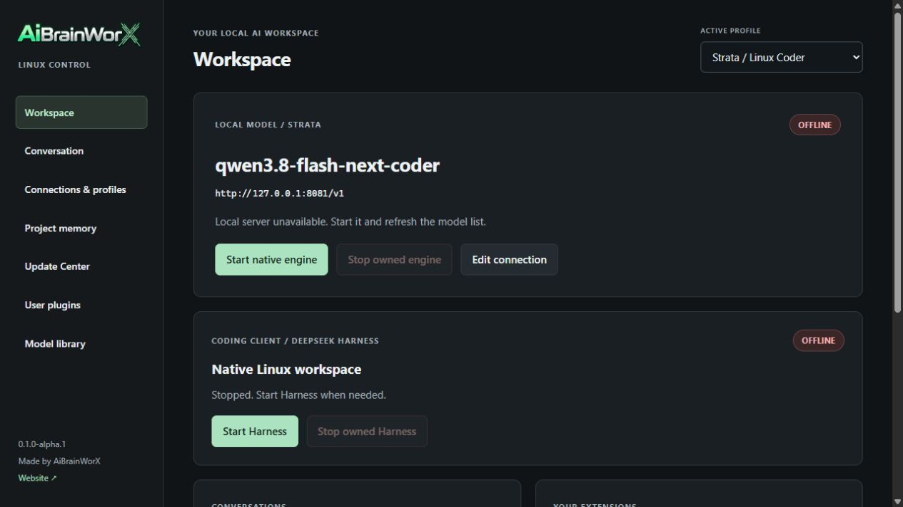

# AiBrainWorX Local AI Control — Linux

**Separate native Linux control plane · 0.1.0-alpha.2 · MIT original code**

A local workspace for model connections, profiles, instructions, project memory,
long conversations, source-reviewed model discovery and user-owned extensions.
The Linux process manager is native POSIX; the interface is a self-hosted browser
application on loopback, not a Windows Forms application. No cloud account is
required for local chat. Windows launcher source and runtime state are separate.



## Run

Requirements: Linux with Python 3.11+, SQLite and a browser. Ubuntu 24.04 WSL2 is
the development/test environment. An installed compatible model server and its
weights are separate prerequisites. No weights or engines are bundled.

```bash
bash Setup.sh
bash Launch.sh
```

Open `http://127.0.0.1:8765` if a browser does not open automatically. The separate
model gateway is `127.0.0.1:8766`; the model API has its own configured port.
Use `--no-browser`, `--port`, `--gateway-port` or `--state` when needed.

State uses the per-user Linux data directory (`XDG_STATE_HOME`, or the standard
Linux state location). The app folder can move independently. Python,
GPU drivers, runtimes and model files still need installation on each machine.
This is not a dependency-free standalone executable.

Use native Linux storage for state and Node runtimes, especially in WSL. Windows
mounts can have slow module loading and may not enforce the private permission
bits Harness requires. Its security check is preserved, not bypassed.

## Optional native runtimes

The explicit installer targets x86-64 Linux with an NVIDIA GPU and a compatible
CUDA 13 driver. Other hardware can connect a separately installed backend.

```bash
python3 install-linux-runtimes.py
python3 install-linux-runtimes.py --install
```

The first command prints a plan. The second installs official Node 24, pinned
DeepSeek Harness, Strata 0.2.6 and its checksum-verified Linux CUDA13 engine in the
private runtime cache. It does not download weights or start a model. On Ubuntu,
Python's venv support must already be installed (`python3-venv`).

`--reuse-strata-config /opt/strata/strata-coder.json` can map an existing WSL-accessible
Windows configuration to its existing weights. It saves a separate Linux config;
the original is never changed. `--runtime-root` and `--state` can select different
native Linux folders. Configure the resulting Strata connection in the UI.

Harness has separate Start, Stop and Open controls on the workspace. Its default
Linux port is 3081, its profile is private, and its process sign-in URL is opened
only when requested. The Windows Harness at 3080 is left alone.

## Connect a model

In **Connections & profiles**, set the loopback API, exact installed model ID and
actual configured context. Save a profile. Start an external backend in its own
app, or provide an installed Linux executable, working directory and JSON argument
array for the native launcher. It passes arguments without a shell.

For raw llama.cpp, point `-m` at the first existing GGUF shard and configure the
usual loopback host/port arguments for that installed version. The app does not
merge shards, download files, guess quant compatibility or increase context.
Strata-specific flags are not interchangeable with llama.cpp flags. Memory locking
is optional and requires enough physical RAM and memlock allowance.

Native lifecycle uses `start_new_session=True`, `/proc` identity checks and
SIGTERM followed by SIGKILL only for verified surviving owned processes. It
never kills whichever process happens to occupy a model port. Other services and
the Windows model remain independently managed.
The checks retain the executable identity even when Node changes its process title.

## Included

- Reused MIT profile, local SQLite project-memory, model catalog and bridge code.
- 56 model profiles and original skills, with separate third-party/model licenses.
- Streamed chat with strict supported-backend output budgeting, two bounded text
  continuations and stable visible sessions with local transcript/context handoffs.
- Saved instructions, sampling controls, reasoning and output caps.
- Read-only Update Center and explicit model-source provenance records.
- Versioned user plugins outside the installation; source approval required.
- Preview-first customization migration into a separate candidate update folder.
- `CODEX_NOTES.md` for human-reviewed Codex/Gemini collaboration.

Read [context/output behavior](docs/context-and-output.md),
[Update Center](docs/update-center.md), [plugins/migration](docs/user-plugins.md)
and [model licensing](MODEL-LICENSES.md). Original MIT code does not relicense
model weights, third-party runtimes, brands or external services.

## Current acceptance limits

The UI and native process controller are tested inside WSL. Native engine tests
use a small Python process fixture, not a claimed Qwen benchmark. The running
Windows Strata model was separately used to validate the shared gateway. WSL's
assigned RAM and Windows GPU use can limit a concurrent Linux model. No Linux
model weights were downloaded. Native Strata 0.2.6 with NVIDIA engine 0.1.50 and
Harness 0.2.1-rc.2 were installed separately from official sources. The native
Strata API started in lazy/unloaded mode and shut down cleanly; generation and
throughput have not been tested in Linux.
Native Harness also reached sign-in-protected Ready and stopped cleanly. The
current local suite contains 88 passing tests plus 10 bridge contract checks.

Strict counting is currently validated for installed Strata text adapters and
llama.cpp-style token-count endpoints. Ollama/LM Studio retain connector transport,
but lack validated exact counting and automatic native session handoffs here.
Reasoning, tool JSON and Responses are not silently stitched. Summaries can lose
details. Voice/audio hooks, Linux video playback, native app packaging and live
Unreal/Blender/Android acceptance are not claimed by this alpha.

Update checks never install anything. Plugins are trusted local programs, not a
sandbox. Local transcripts, settings and memory are unencrypted; keep the state
folder private. No public listener, telemetry, tunnel or firewall rule is created.

## Activity and update visibility

The Activity page adds optional API-1 monitoring, explicit read-only process snapshots and hot plugin disable/archive/restore. Core service LEDs remain independent of extensions. Updates show actual completed source-check jobs. [Guide](docs/activity-monitor.md) · [Cross-platform validation record](docs/validation/2026-10-26-activity.md).
